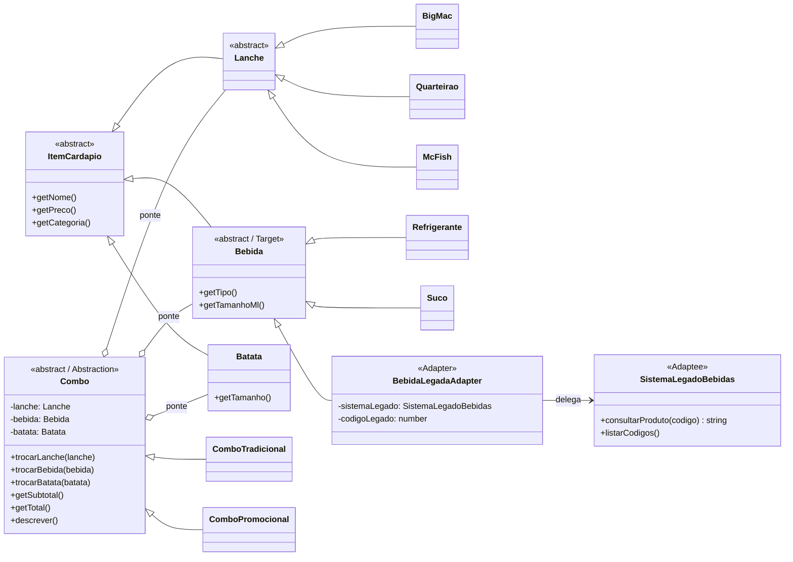

# 🍔 Sistema de Combos – Padrões GoF Bridge + Adapter

Projeto prático de **padrões estruturais GoF** em JavaScript (Node.js): um sistema de personalização de combos de fast-food em que o cliente escolhe livremente o lanche, a bebida e a batata frita.

- **Bridge**: combina lanches, bebidas e batatas **sem criar uma classe para cada combinação**, e permite trocar itens em tempo de execução.
- **Adapter**: usa as bebidas de um **sistema legado** (códigos 101–103 e 201–203) no novo sistema, **sem modificar o código legado**.

> Os preços são fictícios, usados apenas para a demonstração.

## Como executar

Requisito: Node.js 18 ou superior (sem dependências externas).

```bash
git clone https://github.com/SEU_USUARIO/mc-combo-bridge-adapter.git
cd mc-combo-bridge-adapter
npm start
```

## Cardápio

| Item    | Opções                                                    |
|---------|-----------------------------------------------------------|
| Lanche  | Big Mac, Quarteirão, McFish                               |
| Bebida  | Refrigerante ou Suco – 300 ml, 500 ml ou 700 ml           |
| Batata  | Pequena, média ou grande                                  |

São **54 combinações possíveis** (3 × 6 × 3) feitas com só 3 classes de lanche, 2 de bebida e 1 de batata.

## Classes responsáveis por cada padrão

### Bridge

| Papel no padrão            | Classe(s)                                           | Arquivo |
|----------------------------|-----------------------------------------------------|---------|
| **Abstraction**            | `Combo`                                             | `src/bridge/Combo.js` |
| **Refined Abstraction**    | `ComboTradicional`, `ComboPromocional`              | `src/bridge/ComboTradicional.js`, `src/bridge/ComboPromocional.js` |
| **Implementor**            | `Lanche`, `Bebida`, `Batata` (base `ItemCardapio`)  | `src/cardapio/` |
| **Concrete Implementor**   | `BigMac`, `Quarteirao`, `McFish`, `Refrigerante`, `Suco`, `Batata` | `src/cardapio/` |

**Como funciona:** o `Combo` não herda dos itens nem existe uma classe como `ComboBigMacRefri500BatataMedia`. Ele **guarda referências** (composição) para um `Lanche`, uma `Bebida` e uma `Batata`. Essa referência é a "ponte" entre os dois lados:

- **Lado da abstração**: os tipos de combo (tradicional com 10% de desconto, promocional com desconto configurável).
- **Lado da implementação**: os itens do cardápio.

Os dois lados crescem de forma independente. Um novo tipo de combo não exige mudar nenhum item, e um novo lanche não exige mudar nenhum combo. Os métodos `trocarLanche()`, `trocarBebida()` e `trocarBatata()` trocam a implementação **em tempo de execução**.

Sem o Bridge, seriam necessárias 54 classes de combo, e o dobro com o combo promocional.

### Adapter

| Papel no padrão | Classe                 | Arquivo |
|-----------------|------------------------|---------|
| **Target**      | `Bebida`               | `src/cardapio/Bebida.js` |
| **Adaptee**     | `SistemaLegadoBebidas` | `src/legado/SistemaLegadoBebidas.js` |
| **Adapter**     | `BebidaLegadaAdapter`  | `src/adapter/BebidaLegadaAdapter.js` |
| **Client**      | `Combo`                | `src/bridge/Combo.js` |

**O problema:** o sistema legado identifica bebidas por código numérico e responde com um texto no formato `"TIPO;ML;PRECO_EM_CENTAVOS"`, por exemplo `consultarProduto(202)` → `"SUCO;500;950"`. O `Combo` espera um objeto `Bebida`, com `getNome()`, `getPreco()` e `getTamanhoMl()`.

**A solução:** o `BebidaLegadaAdapter` é um *adaptador de objeto* que usa:

- **Herança**: `extends Bebida`, então o `Combo` o aceita como qualquer outra bebida.
- **Composição**: guarda uma referência ao `SistemaLegadoBebidas`, delega a ele a consulta pelo código e traduz a resposta para a interface nova.

| Código | Bebida             |
|--------|--------------------|
| 101    | Refrigerante 300 ml |
| 102    | Refrigerante 500 ml |
| 103    | Refrigerante 700 ml |
| 201    | Suco 300 ml         |
| 202    | Suco 500 ml         |
| 203    | Suco 700 ml         |

O arquivo `SistemaLegadoBebidas.js` **não é alterado** em nenhum momento.

### Integração entre os padrões

O Adapter entrega um objeto que **é uma `Bebida`**, então ele entra direto na ponte do Bridge: `combo.trocarBebida(new BebidaLegadaAdapter(sistemaLegado, 103))`. O `Combo` não sabe, nem precisa saber, que aquela bebida veio do sistema legado.

## Diagrama de classes



## O que o programa demonstra (`npm start`)

1. **Montagem de 5 combos diferentes**: 3 tradicionais e 2 promocionais, com lanches, bebidas e batatas variados.
2. **Personalização de combos existentes**: troca de bebida, troca do tamanho da batata, troca dos dois ao mesmo tempo e troca do tamanho da bebida, mostrando o antes e o depois.
3. **Adapter**:
   - mostra a resposta "crua" do sistema legado e a bebida já convertida;
   - cria um **novo combo** com a bebida legada de código 202;
   - troca a bebida de um combo existente por uma legada (código 103);
   - trata erros: código legado inexistente e item do tipo errado.
4. **Resumo do pedido** com o total de cada combo e do pedido.

## Evidências de execução

- [`evidencias/saida-terminal.txt`](evidencias/saida-terminal.txt) e [`evidencias/evidencia-terminal.png`](evidencias/evidencia-terminal.png): saída completa do `npm start`.

Trecho da saída:

```
▶ Criando um NOVO combo com a bebida legada de código 202 (Suco 500 ml):
┌─ Combo 6 · Combo Tradicional
│  Lanche:  McFish                                       R$ 22,90
│  Bebida:  Suco 500 ml [legado cód. 202]                 R$ 9,50
│  Batata:  Batata frita média                            R$ 9,90
│           Subtotal                                     R$ 42,30
│           Desconto (10%)                               -R$ 4,23
└─          TOTAL DO COMBO                               R$ 38,07
```

## Estrutura do projeto

```
├── index.js                          → demonstração no terminal
├── package.json
├── evidencias/
│   └── saida-terminal.txt            → saída da execução
└── src/
    ├── cardapio/                     → BRIDGE: Implementors
    │   ├── ItemCardapio.js
    │   ├── Lanche.js                 (Lanche, BigMac, Quarteirao, McFish)
    │   ├── Bebida.js                 (Bebida, Refrigerante, Suco) – também é o Target do Adapter
    │   └── Batata.js
    ├── bridge/                       → BRIDGE: Abstraction e Refined Abstractions
    │   ├── Combo.js
    │   ├── ComboTradicional.js
    │   └── ComboPromocional.js
    ├── legado/                       → ADAPTER: Adaptee (não modificar)
    │   └── SistemaLegadoBebidas.js
    ├── adapter/                      → ADAPTER: Adapter
    │   └── BebidaLegadaAdapter.js
    └── util/
        └── moeda.js                  → formatação em R$ (valores em centavos)
```

## Conceitos de POO utilizados

- **Classes e herança**: `ItemCardapio → Lanche → BigMac`; `Combo → ComboTradicional`; `Bebida → BebidaLegadaAdapter`.
- **Composição**: o `Combo` contém um lanche, uma bebida e uma batata; o adapter contém o sistema legado.
- **Classes abstratas**: `ItemCardapio`, `Lanche`, `Bebida` e `Combo` impedem a instanciação direta com `new.target`.
- **Polimorfismo**: `getPercentualDesconto()` e `getTipo()` mudam conforme o tipo de combo; `getNome()` é sobrescrito no adapter.
- **Encapsulamento**: os itens só são trocados pelos métodos `trocar*()`, que validam o tipo recebido.
